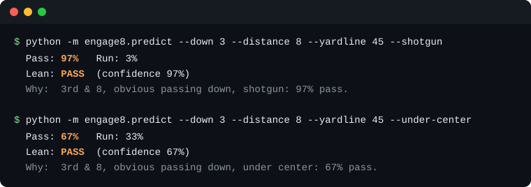

# Engage Eight


Engage Eight predicts whether a football offense will run or pass before the
snap, and shows a defense what an opponent likes to do in each situation. It
learns from five seasons of open NFL play-by-play and from your own Hudl film.

- **Calibrated** run/pass calls from down, distance, field position, clock,
  score, and QB alignment. On plays it called about 75% pass, offenses passed
  75.5% of the time.
- **Opponent tendencies** by down and distance, field zone, formation, motion,
  quarter, and hash, from a Hudl export or a hand-charted CSV.
- Predictions that **adjust to your opponent**. Upload their film and the call
  shifts toward what they actually do, along with how many plays back it up.
- Defensive call suggestions for the situation. These come from written rules,
  not the model, and the app labels them that way.

<p align="center">
  
</p>

Both are 3rd and 8 from the 45. The only thing that changed is where the
quarterback lined up, and it moved the call 30 points.

## Why I built it

I've played football for a long time and the players I grew up watching,
Luke Kuechly, Peyton Manning, Tom Brady, Ray Lewis, stood out because they knew
what was coming before the ball was snapped. I wanted a tool that does some of
that film work for me and lets me check my own pre-snap reads. I also think AI
is going to change how teams scout, and I wanted to see how far one person could
get with free data and no budget.

## How it works

1. The pipeline downloads NFL play-by-play from nflverse for 2019 to 2023,
   173,881 run and pass plays.
2. A LightGBM model learns run vs pass from what a coach can see before the
   snap. A separate season is held back to calibrate its probabilities.
3. Coaches upload film as a Hudl breakdown export or a simple charting CSV.
   Each team's plays are private to that team.
4. When you predict against an opponent you have film on, the model's number
   gets pulled toward what that team did in the same spot. More plays, bigger
   pull. The app shows each step so you can tell 4 plays from 40.
5. A short set of written rules turns the lean and the situation into two or
   three defensive calls.

## Results

Trained on 2019 to 2021, calibrated on 2022, and tested on all 35,474 plays of
the 2023 season, which the model never saw.

| | Accuracy | AUC | Brier |
|---|---|---|---|
| With shotgun and tempo known | 74.1% | 0.816 | 0.169 |
| Down, distance, clock, score only | 70.5% | 0.785 | 0.181 |
| Always guess pass | 61.3% | | |

A few decisions behind those numbers:

- The test set is a whole later season, not a random sample. A random split
  lets the model see other plays from the same games and makes it look better
  than it is.
- "Pass" means a called pass, so scrambles and sacks count. That's the play the
  defense has to stop.
- The model only uses what a coach can know before the snap. An earlier version
  leaned on NFL team names, which don't help when you're scouting a high school
  team, so I took them out. Accuracy went up slightly.

## Usage

The trained model is checked in, so you don't have to train anything to try it.

### Run everything with Docker

<details><summary><b>Show instructions</b></summary>

1. Set a secret for signing logins. The API won't start without one.

   ```sh
   export ENGAGE8_JWT_SECRET=$(openssl rand -hex 32)
   ```

2. Start Postgres, the API, and the dashboard.

   ```sh
   docker compose up --build
   ```

3. Open http://localhost:8080. The API docs are at http://localhost:8000/docs.

</details>

### Run the API and dashboard locally

<details><summary><b>Show instructions</b></summary>

1. Start the API. The example env file turns on dev mode and uses SQLite.

   ```sh
   cd api
   python -m venv .venv && source .venv/bin/activate
   pip install -r requirements.txt
   cp .env.example .env
   uvicorn app.main:app --reload
   ```

2. In a second terminal, start the dashboard.

   ```sh
   cd web
   npm install
   npm run dev
   ```

3. Open http://localhost:5173, create an account and a team, and upload a CSV.
   There's a sample Hudl export in `ml/tests/fixtures/`.

More in [api/README.md](api/README.md) and [web/README.md](web/README.md).

</details>

### Retrain the model

<details><summary><b>Show instructions</b></summary>

1. Install and run the tests. They don't need the network.

   ```sh
   cd ml
   pip install -r requirements.txt
   python -m pytest
   ```

2. Download the data, build features, and train. The new model is written to
   `ml/models/` with its test metrics.

   ```sh
   python -m engage8.extract --seasons 2019 2020 2021 2022 2023
   python -m engage8.features
   python -m engage8.train
   ```

3. Try it.

   ```sh
   python -m engage8.predict --down 3 --distance 8 --yardline 45 --shotgun
   ```

More in [ml/README.md](ml/README.md).

</details>

## Built with

- `ml/`: Python, pandas, LightGBM with isotonic calibration.
- `api/`: FastAPI, SQLAlchemy, Alembic, Postgres (SQLite locally), JWT auth.
- `web/`: React and TypeScript with Vite.
- Docker Compose for the whole stack, and GitHub Actions to run the tests and
  build the images on every push.

## What's next

- A quiz mode: see a real NFL situation, call run or pass, and compare yourself
  to the model.
- A one-click demo with sample opponent data, hosted somewhere you can just
  open.
- Train on high school and college film once I have enough of it. Right now the
  opponent adjustment sits on top of an NFL model.

## Data and license

Play-by-play data comes from [nflverse](https://github.com/nflverse). MIT
license, see [LICENSE](LICENSE).
